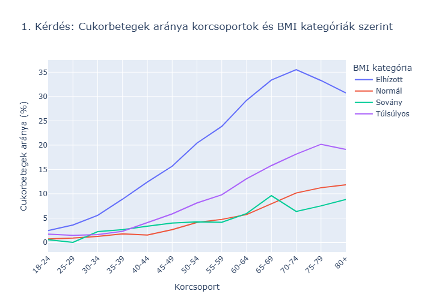
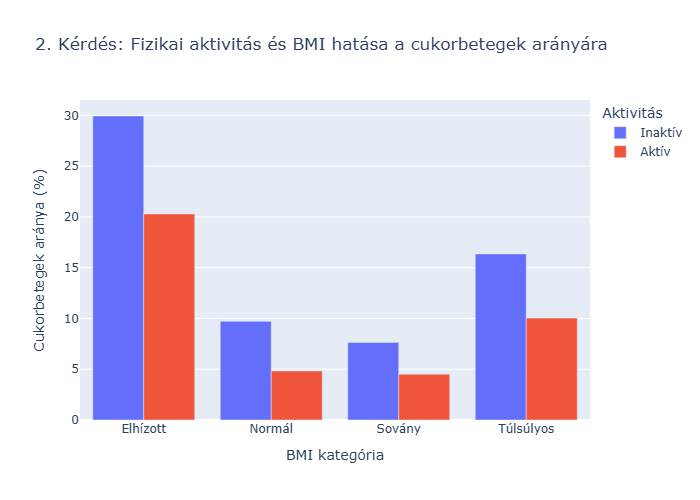
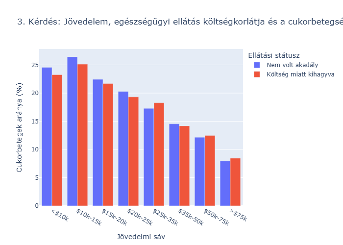
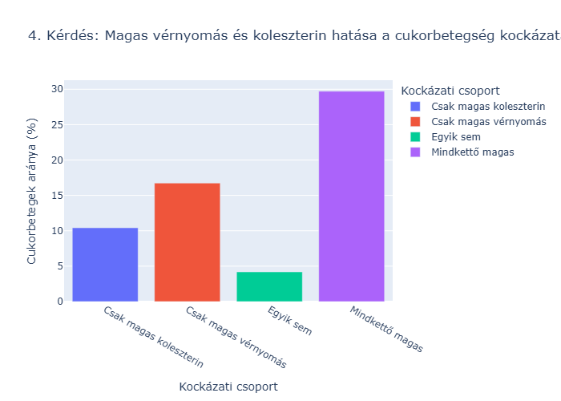
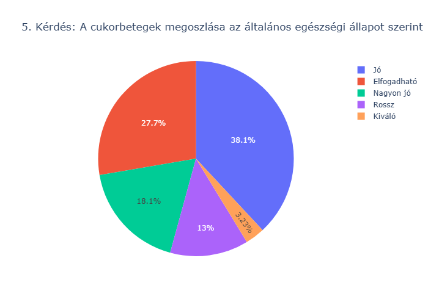

# Cukorbetegséghez kapcsolódó kockázati tényezők elemzése | Dobri Dominik Nátán | IL5ATW

Ebben a projektben a CDC 2015-ös BRFSS egészségügyi felmérésének adatait vizsgálom. A cél az volt, hogy az adathalmazból kiszedve és diagrammá alakítva, mely életmódbeli, egészségügyi és anyagi tényezők állhatnak kapcsolatban a cukorbetegség előfordulásával.

Az elemzés a `diabetes_binary_health_indicators_BRFSS2015.csv` adatállományra épül. Az adatfeldolgozáshoz és a grafikonok elkészítéséhez Pythont, valamint a `pandas`, `numpy` és `plotly.express` könyvtárakat használtam.

Az eredeti kaggle oldal linkje itt található: https://www.kaggle.com/datasets/alexteboul/diabetes-health-indicators-dataset/data?select=diabetes_binary_health_indicators_BRFSS2015.csv


## A projekt tartalma

- `elemzes.py` - itt van az egész program kódja
- `diabetes_binary_health_indicators_BRFSS2015.csv` - a felhasznált adatállomány
- `kepek/` - a diagramok ebben a mappaba mentődnek el

## Futtatás

Először telepítenünk kell a szükséges csomagokat. A `kaleido` azért kell, hogy mappába tudjuk menteni png-ként.

```bash
pip install pandas numpy plotly kaleido
```

Ezután futtatni kell az elemzes.py-t:

```bash
python elemzes.py
```

A program futtatásakor a CSV-fájlnak és a `kepek` mappának az `elemzes.py` mellett kell lennie.
Illetve még fontos dolog, hogyha újra le akarjuk futtatni a programot akkor elötte ki kell törölnünk a képeket a kepek mappából, különben errort dob.

## Vizsgált kérdések

Az alábbi öt kérdés mentén néztem meg az adatokat. A grafikonok alatt a saját véleményem, következtetéseimet fogom leírni.(Ez csak tényleg saját megállapítás, nem szakmai vélemény.)

### 1. Hogyan változik a cukorbetegek aránya korcsoport és BMI szerint?



Saját véleményem.:

Az 1. diagrammon látható, hogy az életkor előrehaladásával minden testsúlycsoportban nő a cukorbetegek aránya, de a magasabb BMI ezt drasztikusan felerősíti. Az elhízott kategóriában már fiatalabb korban is jóval magasabb az érintettek száma mint a normál testsúlyúaknál idősebb korban.

### 2. Milyen kapcsolat figyelhető meg a fizikai aktivitás, a BMI és a cukorbetegség között?



Saját véleményem.:

A 2. diagram jól mutatja, hogy a rendszeres aktív életmód kedvező kapcsolatban állhat a cukorbetegség alacsonyabb előfordulásával. Ez minden súlycsoportban jól látszik. Ez alapján a mozgás fontos szerepet játszhat a megelőzésben és az egészségesebb életmód kialakításában. 

### 3. Hogyan függ össze a jövedelem, az egészségügyi ellátás költség miatti kihagyása és a cukorbetegség?



Saját véleményem.:

A 3. diagram szerintem jól szemlélteti azt, hogy kisebb jövedelemmel rendelkező emberenél ha tudott fordítani pénzt ellátásra ha nem, akkor is magas volt az arány. Az én megállapításom szerint ez azért van, mert rengeteg akár krónikus stresszt is tud okozni, hogyha kevés jövedelemmel rendelkezik valaki. És ez nagyon erősen ki tud hatni az egészségre.

### 4. Milyen kapcsolatban áll a magas vérnyomás és a magas koleszterinszint a cukorbetegséggel?



Saját véleményem.:

a 4. diagrammon jól látható, hogy külön-külön is erősen megtudják növelni a cukorbetegség kockázatát de ha mind a kettő fenáll akkor ugrásszerű növekedéshez vezet az egészséges csoporthoz képest.

### 5. Hogyan alakul a cukorbetegek megoszlása az általános egészségi állapot megítélése alapján?



Saját véleményem.:

Az 5. diagramról leolvasható, hogy csak a cukorbetegek egy töredéke(~3%) érzi kivállónak az egészségi állapotát, mind a legnagyobb "szeletek" a jó és az elfogadható kategóriába tették magukat. Ennek ellenére a rossz arány is magas ami mutatja mennyire is megterhelő a szervezet számára ez a betegség.


